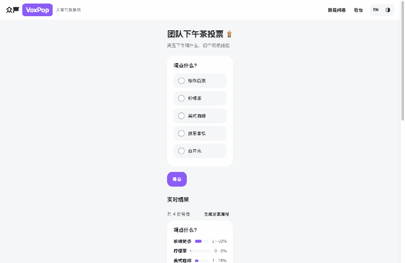
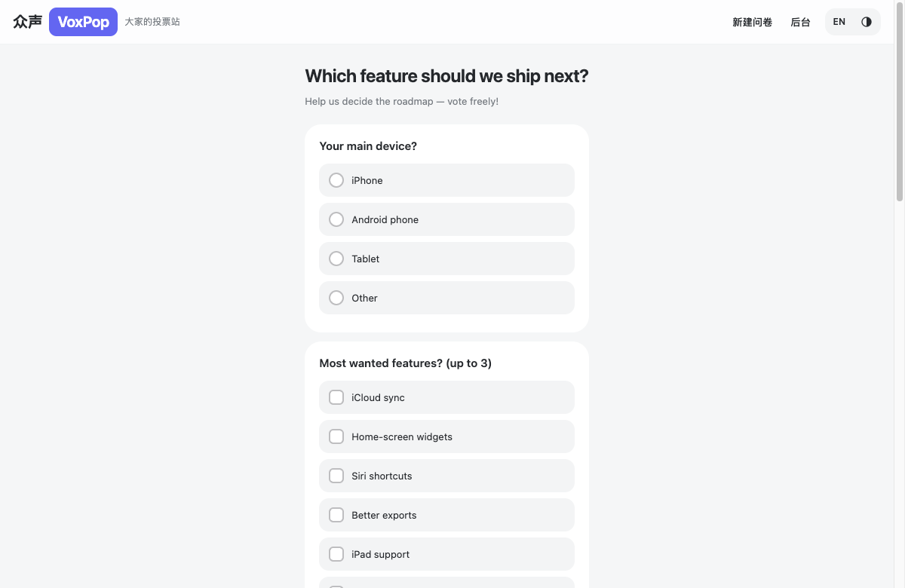
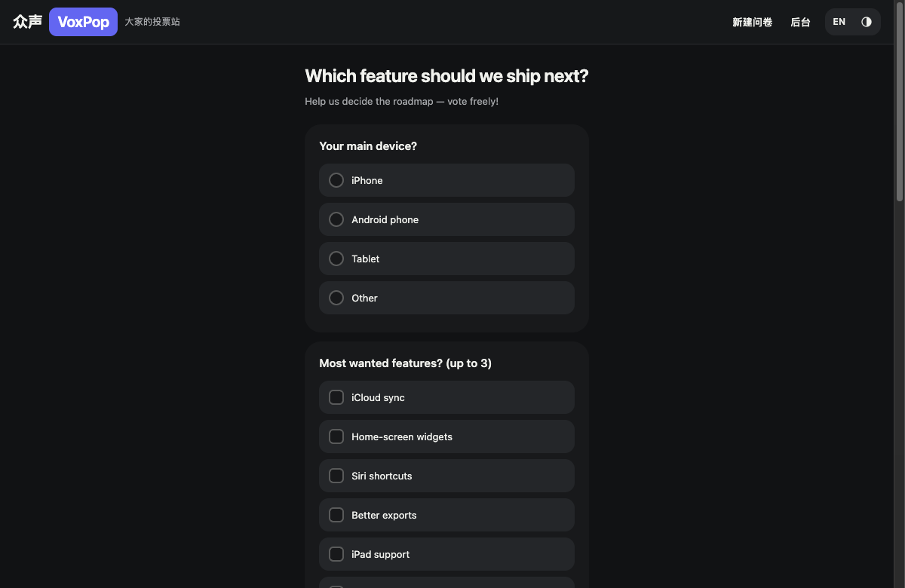
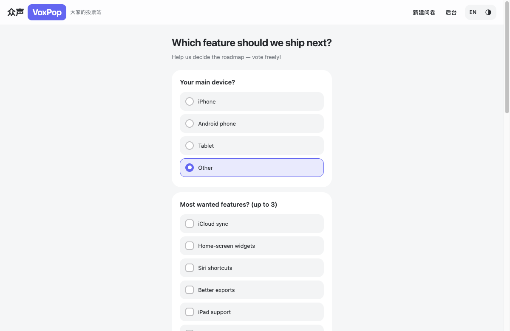

# 众声 VoxPop 🗳️

> **VoxPop**（vox populi，人民之声）—— 跑在 Cloudflare 免费层上的开源投票站：5 分钟自部署、永久零成本、自带防重复提交与轻量埋点统计、一行代码嵌入任意网页。

[English](README.en.md) | 中文

[](https://deploy.workers.cloudflare.com/?url=https://github.com/TNT-Likely/voxpop)

**在线 Demo**：[voxpop-demo.sunxiaoyes.workers.dev](https://voxpop-demo.sunxiaoyes.workers.dev)（预置演示数据，随便投）

## 预览



| 日间 | 暗黑 |
|---|---|
|  |  |

实时结果：表单下方同步更新，投完立即可见。



## 特性

- **四种题型**：单选 / 多选 / 级联选择（≤3 层）/ 文本输入
- **四层防重复提交**：Turnstile 人机校验 → 一方 Cookie + HMAC 指纹 → 事务预检 → 数据库唯一约束
- **内置轻量埋点**：PV/UV、国家、设备、浏览器、OS、来源、时段，**自定义维度**（App / 官网可透传 URL 参数，白名单制）
- **中英双语**：按 Accept-Language 自动识别，`?lang=en|zh` 可切换
- **明暗主题**：跟随系统 + 手动三态切换（自动 / 日间 / 暗黑），嵌入可用 `?theme=dark` 指定
- **主题色注入**：问卷可配主题色，嵌入可用 `?accent=RRGGBB` 换肤，海报跟随
- **三端适配**：移动端 / iPad / PC
- **二维码分享海报**：结果页一键生成带二维码的分享图
- **自助建卷**：`/new` 公开页创建（Turnstile + 每设备每日 5 份限额，默认不收录，管理员可收录）
- **App 发现接口**：`/api/app/polls?app=&channel=`，应用 × 渠道双维定向（自定义标签，如 `appstore` / `ipa` / `apk` / `googleplay`），供 App 内投票横幅使用
- **一行代码嵌入**：`embed.js` iframe 自适应高度
- **零成本**：Workers + D1 + Turnstile 全部落在 Cloudflare 免费额度内，无需 VPS
- **隐私友好**：不存原始 IP / UA，只有 HMAC 摘要与枚举，无 PII
- **零依赖**：除 Hono 与 Chart.js（后台图表 CDN）外，前端为原生 JS

## 部署

前置：Cloudflare 账号（免费计划即可）+ Node.js 20+。

```bash
git clone https://github.com/TNT-Likely/voxpop.git
cd voxpop
npm install
npx wrangler d1 create voxpop    # 把输出的 database_id 回填到 wrangler.jsonc
cp .dev.vars.example .dev.vars   # 本地开发配置
npm run db:local                 # 初始化本地库（远端用 npm run db:remote）

# 线上密钥（管理后台密码 + HMAC 盐）
npx wrangler secret put ADMIN_KEY
npx wrangler secret put SERVER_SALT
# 可选：Cloudflare Dashboard → Turnstile 免费创建站点，然后：
# npx wrangler secret put TURNSTILE_SECRET_KEY，并把 site key 填入 wrangler.jsonc 的 vars

npm run deploy
```

后台：`https://<你的域名>/admin`，输入 `ADMIN_KEY` 登录，即可建问卷、看数据、拿嵌入码。

### 一键部署（Deploy to Cloudflare）

点顶部 Deploy 按钮，Cloudflare 会克隆仓库并自动创建 Worker 与 D1；完成后补三步：

```bash
npx wrangler secret put ADMIN_KEY     # 管理后台密码
npx wrangler secret put SERVER_SALT   # 随机长字符串（HMAC 盐）
npx wrangler d1 execute voxpop --remote --file=./migrations/0001_init.sql  # 初始化表结构
```

### 启用 Turnstile（可选，免费）

人机校验代码已内置，未配置密钥时自动跳过。启用：

1. Cloudflare Dashboard → **Turnstile** → Add site：域名填你的两个入口（自定义域 + workers.dev），模式选 Managed 或 Invisible，拿到 Site Key / Secret Key；
2. `npx wrangler secret put TURNSTILE_SECRET_KEY`；
3. 把 `"TURNSTILE_SITE_KEY": "0x..."` 加进 `wrangler.jsonc` 的 `vars`，重新 `npm run deploy`。

## 嵌入

后台详情页可以直接复制嵌入代码，等效于：

```html
<script src="https://<你的域名>/embed.js"></script>
<div class="voxpop-poll" data-poll="<问卷ID>"></div>
```

也可以用 npm 包（支持打包器 / UMD）：

```bash
npm install voxpop-embed
```

```js
import VoxPop from 'voxpop-embed';
VoxPop.mount(document.querySelector('#box'), { host: 'https://<你的域名>', poll: '<问卷ID>' });
```

## 本地开发

```bash
npm run dev          # http://localhost:8787
npm run typecheck
npm test
```

内置能力一览：四种题型（含级联 / 文本）、四层防重、Turnstile 开关、埋点与自定义维度白名单、Cron 日聚合（events 明细 180 天保留）、后台 Chart.js 图表、JSON/CSV 导出、embed.js。

## 技术栈

Cloudflare Workers（Hono + TypeScript SSR + Static Assets）· D1（SQLite）· Turnstile（可选）· 前端原生 JS，运行时依赖仅 Hono。

## License

MIT © 2026 TNT-Likely
