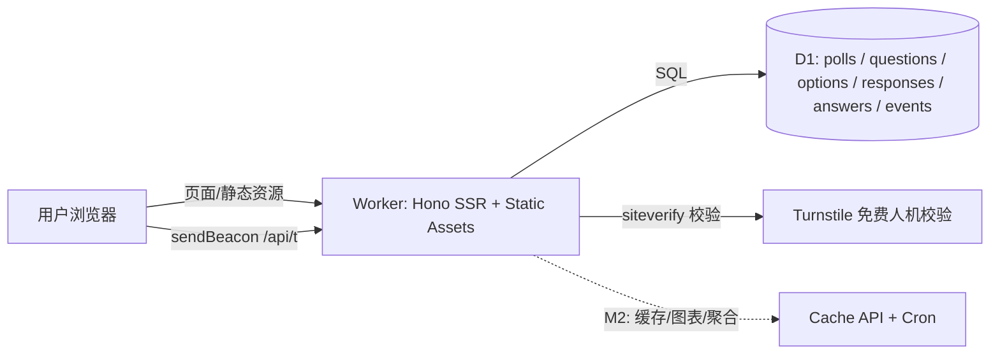

# 众声 VoxPop · 产品与技术方案

> 2026-10-28 · **v2**
> 修订记录：v2 增加级联题、文本输入题、App 自定义维度透传（按用户反馈）；v1 初稿。
> 一句话：跑在 Cloudflare 免费层上的开源投票站——5 分钟自部署、永久零成本、自带防重复提交与轻量埋点统计、一行代码嵌入任意网页。

## 1. 定位

**众声 VoxPop**（vox populi，人民之声）

- 中文口号候选：「大家的投票站」/「把声音投进来」
- 英文 tagline：*VoxPop — a free-forever, embeddable poll service that runs entirely on Cloudflare's free tier.*
- 仓库：`TNT-Likely/voxpop`（public，MIT）

它同时服务两个目的：

| | 说明 |
|---|---|
| 自用 | 蜜蜂记账的「用户共创」入口：功能投票、版本调研（含级联与补充说明）、皮肤票选；顺带沉淀设备 / 浏览器 / App 版本比例数据反哺适配决策 |
| 开源 | 面向「Cloudflare 兓费额度党」、独立开发者、小社区的自部署小工具；这个生态位已被 cloudflare-temp-email 等项目验证过需求 |

## 1.1 命名备选（留档）

| 名字 | 说明 |
|---|---|
| 众声 VoxPop | **已采用**。vox populi 人民之声，国际开源气质最好 |
| 正字 TallyMarks | 正字计票 ↔ tally marks，故事好但略文 |
| 纸条 BallotSlip | 温暖怀旧，GitHub 完全干净 |
| 举手 HandsUp | 口语化亲切，嵌蜜蜂记账自然 |
| 票圈 VoteCircle | 中文传播强，英文弱 |
| 点投 TickVote | 打勾投票谐音点头，有同名小项目 |
| 蜂选 BeePoll | 蜂家族命名，用户否掉 |
| 蜂巢投票 HivePoll / 蜜票 HoneyVote / 蜂鸣 BuzzPoll | 蜂家族备选，未采用 |

## 1.2 开源价值判断（留档）

- 投票类 OSS 多，但「Cloudflare 免费额度自部署」生态位被 cloudflare-temp-email 等验证过；
- 差异化 = 正经的防刷设计与可交叉分析的埋点；
- 预期按「几百 star 的实用小工具」校准，维护负担小。

## 2. 核心功能（MVP 边界）

| 功能 | BeeCount 需要 | 开源版保留 |
|---|---|---|
| 题型 | 单选/多选/级联/文本 | 同左 |
| 防重复提交 | 四层防线（§4） | 同左 |
| 结果展示 | 实时条形图 + 答卷构成 | 同左 |
| 埋点统计 | PV/UV、国家、设备、浏览器、OS、来源、时段 + 自定义维度 | 同左 |
| 管理后台 | 密钥登录、建卷、截止、看数、导出、嵌入码 | 同左 |
| 嵌入 | embed.js 一行代码 | 同左 |

**M1 明确不做**：账号体系、评分 / 排序题、矩阵题、文件上传、图片、游客自助建卷、后台图表库（M2 用 Chart.js）。

## 3. 页面与流程

| 路由 | 说明 |
|---|---|
| `/` | 首页：进行中的调研列表 |
| `/p/:id` | 投票页：逐题作答（级联逐级下拉，必须选到叶子）→（隐形人机校验）→ 提交 → 即时结果 |
| `/embed/:id` | 嵌入版（无站点头部，iframe 专用） |
| `/admin` | 后台：密钥登录 → 建卷（含题型与维度白名单）→ 拿链接和嵌入码 → 看数据 → 导出 JSON |

链接可带自定义维度参数：`/p/:id?src=app&app_ver=4.2.1&platform=ios`（仅白名单键入库）。

API：
- `POST /api/polls/:id/respond` 提交答卷
- `GET /api/polls/:id/results` 公开结果 JSON（带 CORS，供官网消费）
- `POST /api/t` 页面埋点（sendBeacon）
- `GET /api/health`
- `/api/admin/polls`（创建）、`/admin/polls/:id/export`（导出）等

## 4. 技术方案

**栈**：TypeScript + Hono（SSR + API 单 Worker 全包）+ D1 + Turnstile（可选开关）+ Rate Limiting binding。

> Workers 语言：TS 一等公民；官方另有 Python Workers；Rust/Go/C++ 经 WASM；Dart 无官方支持。本项目选 TS。

**数据模型（D1 六表）**：`polls` / `questions`（type: single/multi/cascade/text）/ `options`（parent_id 级联树）/ `responses`（答卷，`UNIQUE(poll_id, voter_hash)`）/ `answers`（option_id 或 text_value）/ `events`（含 `extra` JSON 自定义维度）。见 `migrations/0001_init.sql`。

**防重复提交（四层防线）**：

1. **Turnstile 隐形人机校验**（免费不限量）：提交须带 token，服务端 siteverify；未配置密钥时自动跳过；
2. **身份识别**：一方 Cookie `vp_vid`（1 年，SameSite=None 适配 iframe 嵌入）+ `HMAC-SHA256(SERVER_SALT, poll|ip|UA)` 指纹兜底；按 `dedup_mode` 选主身份；服务端不落原始 IP、UA；
3. **业务预检**：提交前先查 `responses` 是否已存在；
4. **DB 唯一约束** `UNIQUE(poll_id, voter_hash)`：并发、重放插不进第二份答卷。

边界（诚实声明）：防不住「换设备 + 过验证的大规模人力刷票」；对链接传播场景足够，重要调研切 `ip` 模式 + 截止后人工抽查。

**App 自定义维度透传**：

- 打开链接时带 URL 参数（`src`、`app_ver`、`platform` 等）；
- 服务端只收**该问卷在后台配置的白名单键**，值截断 ≤64 字符存 `events.extra` JSON；
- 口径为「自报」，无签名（无 PII、纯统计场景不加复杂度）；
- 交叉分析示例：投「需要 iCloud 同步」的人里 `app_ver` 分布（M2 图表）。

**埋点**：客户端 sendBeacon 上报枚举化信息（不存原始 UA），服务端补 `CF-IPCountry`；`SAMPLE_RATE` 采样开关；`respond` 事件由服务端在提交成功时写入；明细保留 180 天（M2 Cron 聚合后清理）。

**文本答案（UGC）约束**：纯文本、限长（默认 200 字）、渲染转义防 XSS；后台可查看；不做敏感词自动过滤。

**免费额度台账**：

| 组件 | 免费额度 | 本项目消耗 |
|---|---|---|
| Workers | 10 万请求/天（静态资源免费不计额） | 页面 + API + beacon，约 2-3 请求/PV |
| D1 | 500 万行读/天、10 万行写/天、5GB 存储 | 答卷（多题一卷，写入行数≈题数+1）+ 事件 |
| Turnstile | 免费、不限量 | 每次提交 1 次校验 |
| Rate Limiting | 免费计划可用 | respond 接口每 IP 限流 |
| 自定义域名 | 免费 | 先用 workers.dev，随时可绑 |

压测估算：2 万 PV/天 ≈ 4-5 万 Worker 请求 + 8 万 D1 写，额度内；超 5 万 PV 开采样。

**超限降级三档**：拉长缓存 TTL → 调低 `SAMPLE_RATE` → 结果页静态化（M2）。

## 5. 开源策略

- MIT，public 仓库；双语 README；docs/plan.md 即本文件
- M2 目标：Deploy to Cloudflare 一键部署按钮；npm 包 `voxpop-embed`；贡献指南 / issue 模板
- 预期校准：几百 star 的实用小工具；无账号、无敏感数据，维护负担小

## 6. 与蜜蜂记账集成

- 入口：App「关于 / 反馈」页 + 官网 + README 挂调研链接，App 打开时透传 `app_ver` / `platform` 等维度
- 数据：设备 / 浏览器 / OS / 国家 / App 版本比例 → 最低支持版本、适配优先级决策
- 解耦：开源仓库不含任何 BeeCount 私有配置

## 7. 里程碑

| 阶段 | 内容 | 状态 |
|---|---|---|
| M1 MVP | 六表、四种题型、四层防重、结果页、极简后台、埋点写入 | 本仓库已实现 |
| M2 | Turnstile 正式接入验证、Cache API、后台图表（Chart.js）、事件聚合与清理 Cron、Deploy 按钮、npm 包 | 待做 |
| M3 | 主题化、二维码海报、多语言、自助建卷（评估） | 规划 |

## 8. 风险与对策

| 风险 | 对策 |
|---|---|
| D1 写额度 | beacon 采样 + `respond` 与页面事件合并设计 |
| 刷票 | 四层防线；重要调研切 `ip` 模式 |
| Turnstile 未配置 | 未配置即自动跳过（适合自部署用户首次部署） |
| UGC 文本 | 限长、转义、后台可见可删（M1 后台列表） |
| 数据安全 | D1 七天时间点恢复；重要调研定期「导出 JSON」 |
